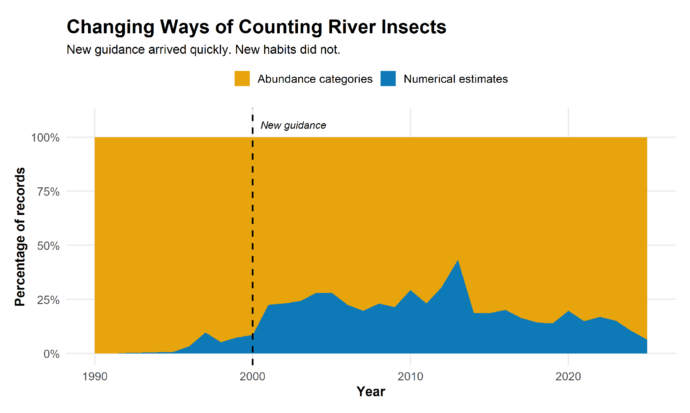
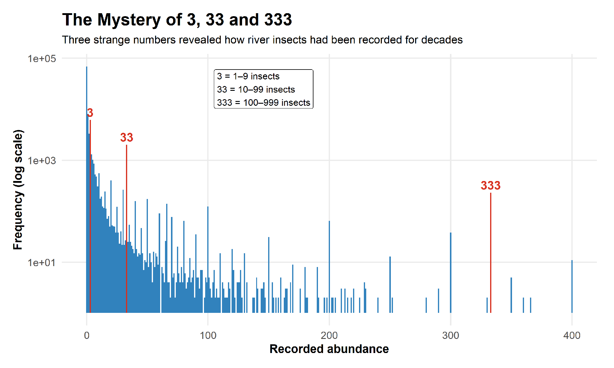
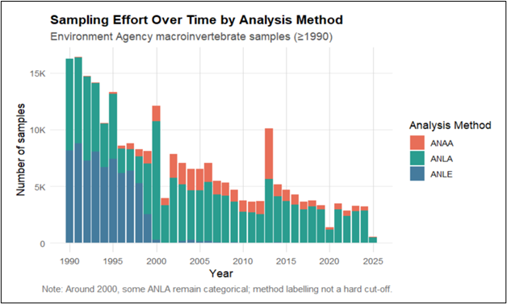
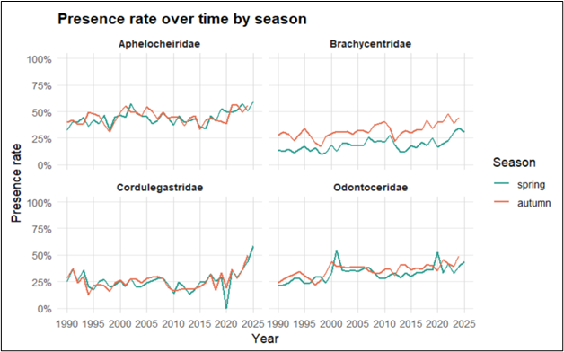
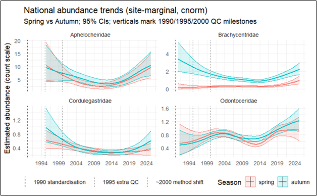

## Introduction
The tiny creatures living on England's riverbeds are among the most sensitive water quality monitors in existence, yet the data recording them is anything but pristine. Working with over 30 years of messy, mixed-format Environment Agency monitoring records, we built a data preparation and modelling workflow that cuts through the noise to reveal a striking national story: England's freshwater macroinvertebrate populations declined sharply into the early 2010s and are now fighting back.

Since the early 1990s, the Environment Agency (EA) has monitored freshwater macroinvertebrates at hundreds of river sites across England, building one of the longest and most comprehensive biomonitoring records in the world. This dataset, spanning over 30 years, hundreds of sites, and millions of individual records, offers a remarkable opportunity to track how England's rivers have changed over time.

::: {.callout-note title="What are freshwater macroinvertebrates?"}
Freshwater macroinvertebrates are small aquatic animals visible to the naked eye, typically found clinging to rocks, sediment, and vegetation on riverbeds. They include insects such as mayflies, stoneflies, and caddisflies, as well as crustaceans, worms, and molluscs. The term "macroinvertebrate" simply means an invertebrate, an animal without a backbone, large enough to be seen without a microscope.
:::

And there is a great deal to track. England's rivers have faced significant environmental pressure over recent decades. Agricultural runoff, sewage discharge, urban development, and industrial pollution have all taken a toll on freshwater ecosystems. At the same time, major policy efforts, from the Water Framework Directive to improvements in wastewater treatment, have aimed to reverse that damage. Whether those efforts have actually worked, and to what degree, is a question that macroinvertebrate monitoring data is uniquely positioned to answer.

But the data is far more complex than it first appears. Records combine different measurement formats; sampling methods have shifted over the decades, and abundance counts are often rounded or incomplete. Turning this wealth of imperfect information into a reliable national picture of river health is a genuine data science challenge on two fronts: cleaning and preparing messy, mixed-format records honestly, and choosing a statistical model that carries measurement uncertainty through to the final results rather than ignoring it. That is exactly what this article is about.

::: {#fig-macroinvertebrates layout-ncol=2 fig-cap="Example macroinvertebrate taxa encountered in routine samples"}

{#fig-shrimp}

{#fig-hydra}

:::

## Background
Freshwater macroinvertebrates are sensitive to environmental change in a way that makes them uniquely useful for monitoring river health. Different species tolerate different levels of pollution; some disappear the moment water quality deteriorates, while others persist even in heavily degraded rivers. By tracking which species are present, in what numbers, and how that changes over time, we can build a far more complete picture of river health than any single chemical test could provide.

The Environment Agency has been drawing on this sensitivity since the early 1990s, when it established a national biomonitoring programme covering hundreds of river sites across England. Field teams visit each site every spring and autumn, using a standardised technique called kick-sampling, turning over riverbed material and catching whatever invertebrates are dislodged, to collect representative samples. This programme represents one of the most extensive freshwater biomonitoring datasets in the world.

For this study, we focused on four invertebrate families from within that dataset. Choosing which families to analyse was not straightforward, with hundreds of taxa recorded across the network, many are too rare to support reliable national trend estimates, and others have seen their identification practices change over time in ways that make long-term comparisons unreliable. The four families we selected, Aphelocheiridae, Brachycentridae, Odontoceridae, and Cordulegastridae, avoid both problems. Each is represented by a single species in the EA dataset; each has been consistently recorded since 1990, and each is ecologically sensitive enough to serve as a meaningful river health indicator.

**Table 1 — The Four Focal Families**

| Family | Common Name | Where Found | What They Indicate |
|---|---|---|---|
| Aphelocheiridae | River bug | Fast-flowing, well-oxygenated rivers | High sensitivity to pollution – their presence signals clean water |
| Brachycentridae | Grannom caddisfly | Gravelly riverbeds in clean streams | Indicator of good water quality and stable habitat |
| Odontoceridae | Silver sedge caddisfly | Cool, fast-flowing upland streams | Sensitive to organic pollution and habitat degradation |
| Cordulegastridae | Golden-ringed dragonfly | Clean, unpolluted streams and rivers | Top predator – signals a healthy, functioning river ecosystem |

## The Data: 30 Years of Monitoring and Its Messiness
The EA dataset spans more than three decades and, across the four families alone, contains over 37,000 samples collected from thousands of river sites covering every major catchment in England. But size and longevity are precisely what make real-world monitoring datasets difficult to work with, not easier. The longer a dataset spans, the more likely it is to have accumulated inconsistencies evolving field practices, shifting recording methods, and changing quality control standards. All that messiness was sitting right there in the data, waiting to cause problems if ignored.

The most significant challenge was one that only becomes apparent when you look closely at how abundance was recorded. Before 2000, field teams recorded invertebrate abundance using a categorical system of broad classes, known as AB classes. A count of anywhere between 1 and 9 individuals was recorded simply as "AB1", 10 to 99 as "AB2", 100 to 999 as "AB3", and so on. In 2000, the EA made a significant shift, switching to numerical abundance recording across the national network. The result is a dataset split across two fundamentally different recording systems, and the two simply cannot be treated as equivalent without introducing serious bias into any trend analysis.

{#fig-counting fig-alt="Proportion of categorical versus numerical abundance records over time, with the 2000 guidance change marked"}

Figure 2 shows this transition directly. Before 2000, virtually all records used abundance categories. After the new guidance arrived, numerical estimates began to appear, but as the subtitle notes, old habits died hard, and categorical recording remained dominant well into the following decade.

The categorical system left its own distinctive fingerprint in the data, one that becomes immediately obvious when looking at the distribution of all recorded abundance values. Rather than a smooth spread of numbers, three values appear with striking frequency: 3, 33 and 333. These are not genuine counts. They are the placeholder values that field teams used to represent each abundance class, 3 for AB1, 33 for AB2, and 333 for AB3. Figure 3 shows just how dominant these three numbers are across the full dataset. Seeing spikes this sharp confirmed that treating any of these records as exact numeric values would be fundamentally wrong.

{#fig-mystery fig-alt="Distribution of recorded abundance values, showing frequent placeholder values of 3, 33 and 333"}

Figure 3 makes this pattern impossible to miss. Across all recorded abundance values in the dataset, three numbers appear with striking frequency: 3, 33 and 333. These are not genuine counts; they are the placeholder values used to represent each categorical abundance class. No real count data would produce spikes like these.

Even within the numerical records collected after 2000, there is a further complication. Counts ending in zero appear far more frequently than chance would predict, a classic fingerprint of one-significant-figure rounding. A recorded count of 20, for example, almost certainly does not mean exactly 20 individuals; it means somewhere in the range of 15 to 24. This is entirely understandable in field conditions, where counting every individual invertebrate in a large sample is rarely practical, and where sub-sampling, counting a fraction of the sample and scaling up, is common practice. But treating these rounded counts as exact values would overstate the precision of the data considerably. Every numeric count was therefore treated as a range rather than an exact figure, one of the most consequential decisions in the entire analysis.

The third challenge is seasonal imbalance. The vast majority of EA surveys take place in spring, March to May, and autumn, September to November, typically twice per year at each site. Outside these windows, data is sparse and inconsistent. This is not a flaw in the programme, it reflects the natural biology of the invertebrates being monitored, whose populations are most stable and most easily sampled in those seasons. But it does mean that any analysis needs to explicitly account for seasonal structure, rather than treating all records as interchangeable regardless of when they were collected.

{#fig-sampling fig-alt="Annual sampling effort from 1990 onwards, grouped by Environment Agency field protocol"}

Figure 4 shows the total number of samples collected each year since 1990, coloured by which of three EA field protocols was used to process them. In short: one protocol (ANLE) records abundance categorically using the AB class system described above, another (ANAA) records it numerically, and the third (ANLA) can go either way depending on the sample. The shift in colours around 2000 reflects the same categorical-to-numeric transition described above, now visible as a change in the mix of protocols used across the network. The chart also makes clear that overall sampling effort has fallen substantially since the early 1990s peak of over 15,000 samples per year, dropping to a few thousand more recently, a decline that, as discussed later, contributes to the wider uncertainty bands visible in the trend estimates for earlier periods.

The table below summarises each challenge with a concrete example of what it looks like in the data and how it was addressed.

**Table 2 — Data Challenges Summary**

| Challenge | Example | How we handled it |
|---|---|---|
| Mix of categorical and numerical records | Pre-2000: “AB2” means 10-99 individuals; post-2000: an actual count of 47 | Classified every sample as categorical or numeric using recording patterns in the data |
| Counts rounded to one significant figure | A recorded count of 20 means anywhere from 15 to 24 | Treated every numeric count as a range, not an exact value |
| Surveys concentrated in spring and autumn | Winter and summer records exist but are too sparse to use reliably | Focused the analysis on spring and autumn only |
| Recording practices shifted around 2000 | Pre-2000 categorical records cannot be directly compared to post-2000 numerical records | Applied consistent, conservative classification rules through |

## From Raw Data to an Analysis-Ready Dataset
Identifying the data challenges is one thing. Preparing the data to handle them honestly is another. Four key decisions shaped everything that followed.

### Decision 1: Classifying every sample as categorical or numeric
The first was classifying every sample as categorical or numeric. The dataset includes a label indicating how abundance was recorded, but this label is not always accurate. Instead, each sample was classified by examining the actual abundance values recorded for every invertebrate species within it, if all non-zero values followed the characteristic placeholder pattern used for categorical classes, 3, 33, 333 and so on, the sample was classified as categorical. Where any ambiguity remained, it was conservatively treated as categorical. When working with messy real-world data, erring on the side of caution is nearly always the right call.

### Decision 2: Adding back absences
The second decision concerned absences. The EA dataset only records families that were actually found. If a family was absent, there is simply no row in the data for that site on that date. For trend analysis, however, absences are just as informative as presences. Absence records were therefore added back in for each family at every site where it had been recorded at least once, ensuring genuine absences were captured rather than lost as missing data.

### Decision 3: Focusing on spring and autumn only
Data from outside the spring and autumn survey windows was excluded. With over three decades of consistent spring and autumn sampling, there was enough data to build robust national trends without the off-season records, a choice made possible by the dataset's depth that would not have been available with a shorter monitoring history. Including sparse and inconsistent off-season records would have introduced more noise than signal, and keeping only the two core seasons meant spring and autumn trends could be estimated separately, rather than averaged together and potentially masking genuine seasonal differences.

### Decision 4: Accounting for site-level variation
Finally, the model was designed to separately account for persistent differences between individual sites. Rivers across England vary enormously in size, geology, land use, and local pollution history and a national trend analysis that ignores these differences risks being distorted by whichever sites happened to be sampled most frequently. Accounting for site-level variation ensures the results reflect genuine national change rather than the characteristics of any particular location.

## The Modelling Approach
The core of the analysis uses a class of models called Generalized Additive Models, or GAMs. Unlike simpler approaches that assume a trend follows a fixed shape like a straight line, a GAM lets the data decide what shape the trend takes. Think of it like drawing a smooth line through a scatter of points by hand, where the line is free to rise, fall, and change direction wherever the data pulls it, rather than being constrained to a predetermined form. This flexibility makes GAMs particularly well suited to long-term environmental monitoring data, where trends rarely follow neat straight lines and the interesting signal is often in the subtle shape of the curve itself.

::: {.callout-note title="Why GAMs for environmental trend analysis?"}
Generalised Additive Models are widely used in ecology and environmental science precisely because they make no assumptions about the shape of a trend. A standard linear regression assumes the relationship between time and abundance is a straight line — which is rarely true over 30 years of monitoring. A GAM instead estimates the trend as a smooth, flexible curve, with the degree of smoothness controlled by the data itself rather than imposed by the analyst. For a comprehensive introduction to GAMs, see Wood (2017) Generalized Additive Models: An Introduction with R, the standard reference text in this area.
:::

Rather than relying on a single model, four complementary GAM-based models were fitted to the same data, each asking a slightly different question about the invertebrate records. The table below summarises what each model asks and why it was included

**Table 3 — The Four Models**

| Model | What it asks | Why included |
|---|---|---|
| Presence/absence | Was the family found or not? | Robust baseline — unaffected by how abundance was recorded |
| Ordered categorical | Are abundance classes shifting over time? | Uses categorical records directly without inventing numeric scores |
| Censored Poisson | What is the count-scale trend? | Cross-check for the primary model |
| Censored normal | What is the population-level abundance trend? | Primary model — handles interval uncertainty and seasonal structure |

The simplest was a presence/absence model, which ignores counts entirely and asks only whether each family was detected at a site or not. Being completely unaffected by the mixed recording formats described in Section 3, it acts as a reliable, format-independent baseline. Across all four families, it showed a consistent pattern: a rise through the late 1990s, a plateau and modest decline through the mid-2000s, and a recovery from around 2015 onwards.

The second model treated abundance as ordered categories, mapping the AB classes directly to ordered levels rather than converting them to numbers. This avoids inventing precision that was never in the original data. Its results closely mirrored the presence/absence findings: an early increase, a dip around 2010, then recovery, reinforcing confidence that the pattern is genuine.

The third model moved to the count-scale data, treating each numeric record as a range rather than an exact value. It captured the same broad multi-decadal shape as the other two, but showed substantially more variability than expected, a sign that it was struggling with the natural heterogeneity in the data. It remained a useful cross-check, but pointed clearly towards the need for a more flexible approach.
The fact that all three models, each making different assumptions and each using the data differently, told the same broad story was itself reassuring. A trend that holds across independent approaches is considerably more credible than one that depends on a single modelling choice.

The fourth model, a censored-normal GAM, was selected as the primary analysis because it directly addresses the limitations of the other three. It uses the full abundance information rather than just presence or absence. It works with both categorical and numeric records. And it handles the natural variability in the data more comfortably, producing well-behaved residuals where the third model struggled. Rather than treating a recorded count of 20 as exactly 20, it treats it as a range of 15 to 24, carrying measurement uncertainty honestly through to the final trend estimates. Separate trend curves were estimated for spring and autumn rather than averaging them together, because for several families the two seasons diverge meaningfully over time, a pattern that would have been invisible in a combined trend.

## What the Data Reveals
The results are, on balance, an encouraging story for England's rivers, though the picture varies enough between families that it is worth describing each one carefully rather than drawing a single sweeping conclusion.

The simplest place to start is with presence alone, setting aside counts entirely and asking just one question: at the sites where each family has ever been recorded, how often is it actually being found? Figure 5 plots that presence rate separately for spring and autumn, for all four families, from 1990 to the present. This provides the closest view of the raw, unmodelled signal available. Raw numeric abundance counts were examined during the data exploration phase; but because they only exist for post-2000 records, are highly skewed towards zeros and small values, and cover only the numeric portion of a mixed-format dataset, showing them directly alongside the model results would give an incomplete and potentially misleading picture.

The presence rate in Figure 5 is a more complete and readable raw-data summary, covering the full time series for both categorical and numeric records. Importantly, the patterns in Figure 5 tell broadly the same story as the model results in Figure 6, the same families show the same broad directions of change. This consistency between the unmodelled presence data and the modelled abundance trends is itself reassuring evidence that the model is capturing something real rather than imposing a pattern that isn't there.

{#fig-presence fig-alt="Presence rate over time by season for each family, with zeros re-injected within each family’s site roster"}

The patterns in Figure 5 are broadly positive but vary by family. Aphelocheiridae shows the clearest signal, relatively stable through the 1990s, some decline through the 2000s, and a clear recovery in recent years. Brachycentridae shows a somewhat different picture, with a trough in the late 2000s followed by a sustained increase from around 2010. Odontoceridae and Cordulegastridae are more variable year to year, though both show a broadly similar direction of change in the most recent period.

But presence alone only tells part of the story. A family might be detected at the same proportion of sites while becoming rarer within each site, or more abundant. Figure 6 shows the headline result: national, population-level abundance trends for all four families on the count scale, with separate spring and autumn curves and 95% confidence bands. The vertical dotted lines mark key EA quality control milestones. The wider confidence bands at the edges of the time series honestly reflect the sparser sampling in those periods. The higher values visible in the early 1990s for some families are not simply the result of a few outlying sites; the model produces national, population-level estimates by averaging over site-level differences, so no single site dominates the trend. Where sample sizes are genuinely small, the model responds by widening the uncertainty bands rather than projecting false confidence. And crucially, the same broad pattern appears in the presence rate plots of Figure 5, which use a completely different approach, if the early high values were artefacts of the count data, they would not show up there too.

{#fig-seasonal-trends fig-alt="National, site-marginal seasonal abundance trends from the censored-normal model across the four focal families"}

The abundance trends tell a more detailed version of the same story, and the four families show related but distinct patterns. Aphelocheiridae shows the clearest and most dramatic arc: high abundance in the early 1990s, a sustained decline bottoming out around 2010 to 2014, and a clear recovery since then, with recent levels approaching those seen at the start of the monitoring period. Cordulegastridae follows a broadly similar shape, with a dip around the late 2000s and an increase from the mid-2010s, though with wider uncertainty bands reflecting the smaller number of samples available for that family.
Brachycentridae tells a somewhat different story. The trough comes earlier, in the late 2000s rather than the early 2010s, followed by a sustained increase from around 2010 onwards. Odontoceridae shows the most subtle signal of the four: a broadly declining trend into the late 2000s followed by a gradual recovery, though the spring and autumn curves track each other closely and the overall magnitude of change is modest compared to the other families.

While the timing and magnitude of change varies between families, the directional message is consistent across all four: none shows a long-term declining trajectory, and all show evidence of stability or recovery in the most recent period, a finding that holds whether you look at presence rates, ordered categories, or modelled abundance trends.

Across all four families, autumn abundance tends to sit above spring abundance for much of the record, most clearly so for Brachycentridae where the two curves separate visibly. For the other three families the spring and autumn curves are closer together, and in places their uncertainty bands overlap, so the seasonal difference should be interpreted with some caution. What is consistent across all families is that a monitoring programme which averages spring and autumn records together, without accounting for the seasonal structure, risks obscuring genuine differences in how populations behave across the year.
What explains the decline and recovery? The models track what happened, not why, but the timing is broadly consistent with what we know about environmental pressures and policy responses in England's rivers. The dips in abundance across families during the 2000s and early 2010s coincided with significant pressure on freshwater ecosystems from agriculture and urban development. The more recent recovery aligns broadly with renewed investment in river management and improvements in wastewater treatment. Whether these changes caused the recovery is a question that goes beyond what this dataset alone can answer, but the signal is there, and it points in an encouraging direction.

## Limitations and Honest Cautions
Every analysis of real-world monitoring data has its limits, and being transparent about them is as important as reporting the findings themselves.

### These are national indicators, not site-level diagnostics
The trends show the broad direction of change across hundreds of sites averaged together. A river that looks healthy in the national picture may still be under significant local pressure. These results are designed for national surveillance and broad comparison across families, not for decisions about individual rivers or catchments. Within that national picture, the timing and magnitude of change also varies between families, as Section 6 describes, so even at the national level the four families should not be treated as interchangeable.

### Recording practices changed significantly around 2000
The shift from categorical to numeric recording around 2000 is the single biggest source of uncertainty in the time series. The data preparation process handles this as carefully as possible, classifying every sample conservatively and treating counts as ranges rather than exact values, but it cannot eliminate all uncertainty about whether apparent changes in the early part of the record reflect genuine biological trends or artefacts of the recording shift. The widening confidence bands in Figure 6 are a direct and honest reflection of this uncertainty.

### The monitoring network has changed over time
Sites have been added and removed, sampling effort has varied across regions, and the number of active sites declined significantly after the early 1990s peak. The model accounts for persistent differences between individual sites, but national trends are well-grounded estimates triangulated across four modelling approaches rather than exact measurements, and that distinction matters when interpreting the results.

### Causation is beyond the scope of this analysis
The models track what happened to invertebrate abundance over time, not why. Establishing a causal link between specific policy interventions and the observed recovery would require additional environmental data such as flow, temperature, and nutrient levels, which goes beyond what this analysis includes. That is a natural next step, not a flaw in the current approach.

## What We Learned
So, are England's rivers recovering? On the evidence of these four families, the answer appears to be yes, cautiously, unevenly, but consistently. That is an encouraging finding, and one that would have been impossible to reach without taking the messiness of the data seriously rather than papering over it.

Three broader lessons emerge from this work that we think apply well beyond this particular dataset. First, messiness is not an excuse to simplify; understanding exactly how data was recorded and preparing it in a way that respects those quirks is what separates a result you can trust from one you cannot. Second, uncertainty should be visible rather than hidden; treating rounded counts as ranges, widening confidence bands where data is sparse, and being honest about what the model cannot say makes results more credible, not less. Third, triangulation builds trust, as Section 5 describes, three complementary models were fitted alongside the primary analysis, each asking a different question about the same data, and all pointed in the same broad direction. That agreement across independent approaches is the strongest evidence that the findings are real.

There is plenty of room to extend this work. Adding environmental covariates such as flow, temperature, and nutrients would help explain why abundance changed, not just that it did. Incorporating spatial structure would allow regional trends to be separated from the national picture. And calibrating the historic categorical AB classes using more recent numeric data would sharpen the early part of the time series considerably. The full code and analysis are reproducible and available on GitHub. If any of this resonates with your own work with environmental monitoring data, we would very much welcome the conversation.

Long-running monitoring datasets are among the most valuable resources environmental science has, but only if someone is willing to do the unglamorous work of understanding them honestly. We hope this project is a small demonstration of what that work can reveal.

## References
1. Pharaoh, E., Diamond, M., Ormerod, S.J., Rutt, G. and Vaughan, I.P. (2023). Evidence of biological recovery from gross pollution in English and Welsh rivers over three decades. Science of the Total Environment, 878, 163107.
2. Qu, Y., Keller, V., Bachiller-Jareno, N., Eastman, M., Edwards, F., Jurgens, M.D., Sumpter, J.P. and Johnson, A.C. (2023). Significant improvement in freshwater invertebrate biodiversity in all types of English rivers over the past 30 years. Science of the Total Environment, 905, 167144.
3. Vaughan, I.P. and Ormerod, S.J. (2012). Large-scale, long-term trends in British river macroinvertebrates. Global Change Biology, 18(7), 2184 to 2194.
4. Wood, S.N. (2017). Generalized Additive Models: An Introduction with R (2nd ed.). Chapman and Hall/CRC.
5. Wood, S.N. (2023). mgcv: Mixed GAM Computation Vehicle with Automatic Smoothness Estimation. R package, version 1.9-0 or later.
6. Environment Agency (2025). Environment Agency Open Data: Ecology Explorer. Available at: https://environment.data.gov.uk/ecology/

## Acknowledgements
We would like to thank our MSc supervisors, Simon N. Wood and Nicole Augustin at the University of Edinburgh, for their methodological guidance, clear teaching, and constructive feedback throughout this project. We are grateful to Mike Dunbar at the Environment Agency for his domain expertise and invaluable guidance on interpreting the EA macroinvertebrate monitoring protocols and data. Special thanks to Zhaoxi Zhang for his support and encouragement throughout the article writing process. We also gratefully acknowledge the Environment Agency for maintaining and providing open access to the national macroinvertebrate datasets used in this study.
## Use of AI tools

During the preparation of this article, AI language tools were used to assist with prose refinement, structural organisation, and editorial clarity. All analysis, modelling, scientific interpretation, and conclusions are entirely the authors’ own. No data were shared with any AI tool.

::: {.article-btn}
[Explore more data science ideas](/applied-insights/index.qmd)
:::

::: {.further-info}
::: grid

::: {.g-col-12 .g-col-md-12}
About the author:
: [Ridhima Gupta](https://www.linkedin.com/in/ridhimagupta1623/) is a statistician and data scientist who specialises in modelling messy, real-world environmental monitoring data and in the careful handling of measurement uncertainty. She holds an MSc in Statistics with Data Science from the University of Edinburgh and a BA (Hons) in Economics with a minor in Computer Science from the University of Delhi. She can be reached on [GitHub](https://github.com/RidhimaGupta4).
: [Tilak Heble](https://www.linkedin.com/in/tilakheble39/) is a data scientist who combines statistical modelling with a growing focus on quantitative finance. He holds an MSc in Statistics with Data Science from the University of Edinburgh and is currently studying for an MSc in Financial Engineering. He is most interested in sectors where data science can power real life innovation, and he is keen to work on research collaborations and join teams that turn data into practical, high-impact solutions. He can be reached on [Github](https://github.com/TilakHeble) 

::: {.g-col-12 .g-col-md-6}
**Copyright and licence** : © 2026 Ridhima Gupta and Tilak Heble 

This article is licensed under a Creative Commons Attribution 4.0 (CC BY 4.0)
<a href="http://creativecommons.org/licenses/by/4.0/?ref=chooser-v1" target="_blank" rel="license noopener noreferrer" style="display:inline-block;">International licence</a>.
:::

::: {.g-col-12 .g-col-md-6}
**How to cite** :  
Gupta, Ridhima, Heble, Tilak 2026. “**Life Below the Surface: What Freshwater Macroinvertebrates Tell Us About England’s River Health**.” *Real World Data Science*, 2026. [URL](https://realworlddatascience.net/applied-insights/case-studies/posts/2026/11/05/life-under-the-surface.html)
:::

:::
:::
