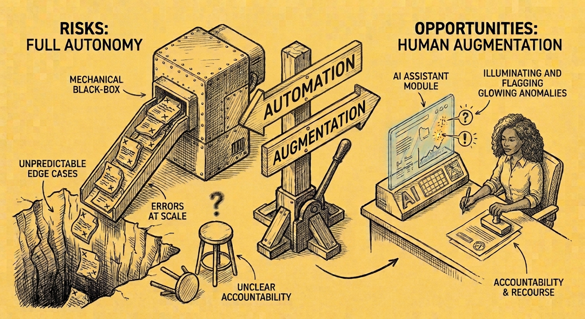
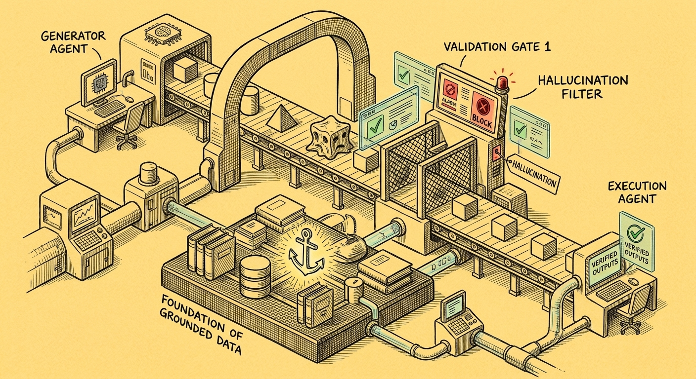
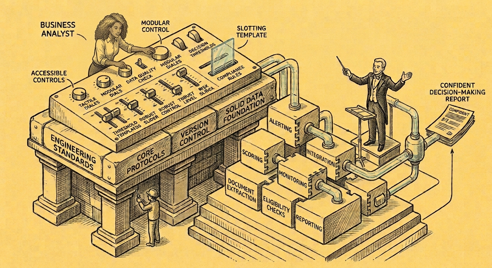

Many organisations are exploring agentic AI systems to automate complex workflows, particularly in environments where large volumes of data must be processed under time pressure. These systems can coordinate multiple steps and use software tools to accomplish defined tasks. While the challenges vary across organisations, a common constraint is not a lack of expertise but the accumulation of friction arising from manual data extraction, repetitive checks, fragmented decision processes, and difficulties scaling expert judgement. These factors can create bottlenecks even where skilled analysts are available, leading to slow outputs, inconsistent assessments, and limited capacity. 

Fully autonomous systems appear to offer a solution, but they introduce a different set of risks. When decision-making is fully delegated to AI systems, accountability and recourse can become unclear, particularly when decisions affect individuals or organisations. Models may also behave unpredictably when faced with cases that differ from those encountered during development. While automated systems can be highly consistent, they may also reproduce errors consistently and at scale. In regulated environments, these risks create tension between efficiency and accountability. A more practical path is to design systems where AI supports human decisions rather than replaces them. This requires a shift in thinking from automation to augmentation. 

{width=80% fig-align="center"}

A useful principle is to treat agentic AI as a structured decision support system rather than an autonomous actor. In this human-in-the-loop approach, agents prepare evidence while people retain responsibility for reviewing or approving decisions where human judgement is required. The goal is not to involve humans in every processing step, but to position them where their judgement adds value, supported by better evidence and less cognitive burden. This reframing avoids the false dichotomy between manual processes and fully automated systems. 

In practice, this requires explicit criteria for determining when human judgement is required. Cases may be escalated based on factors such as uncertainty indicators, conflicting evidence, incomplete data, novel case characteristics, or the potential impact of an incorrect decision. Routine cases with strong supporting evidence may proceed with limited intervention, while uncertain or high-risk cases are routed for human review. Designing these escalation pathways is an essential part of any human-in-the-loop architecture. 

Human oversight should not be assumed to provide perfect assurance. Human reviewers may disagree with one another, overlook important evidence, or become overly reliant on automated recommendations. As confidence in a system grows, there is a risk that reviewers may rely more heavily on its recommendations and examine them less critically. To mitigate this risk, review interfaces should expose supporting evidence, decision rationale, and appropriately validated indicators of uncertainty rather than presenting recommendations as unquestionable outputs. Such indicators require evaluation, as confidence estimates generated by language models do not necessarily correspond to their actual accuracy. Calibration refers to how closely a stated confidence level matches observed accuracy; for example, assessments assigned 80% confidence should be correct approximately 80% of the time. Where confidence estimates inform escalation to human review, their reliability and the associated escalation thresholds should be tested against validated cases. Periodic audits and monitoring of reviewer agreement and override rates can help identify declining levels of scrutiny over time. 

## Designing Modular Agent Architectures 

The architecture that emerges from this approach is modular and task oriented. Instead of relying on a single, monolithic model, responsibilities are distributed across specialised agents. One agent may focus on document extraction, another on eligibility checks, another on scoring or classification, and another on report generation. Each agent operates within a clearly defined scope, producing outputs that feed into the next stage. Separating responsibilities across clearly defined components can make the system easier to understand, maintain, and govern. However, decomposition introduces additional orchestration overhead, latency, cost, and potential failure points. The decision to separate functions across multiple agents should therefore be driven by operational and governance requirements rather than assumed to improve reliability by itself. 

A critical design choice in such systems is the use of structured data throughout the pipeline. Rather than passing unstructured text between components, agents exchange structured information, often using JSON, a standard text format that organises data into labelled fields that software can process consistently. This ensures consistency across stages, reduces ambiguity, and enables downstream processes to operate deterministically. It also allows outputs to be stored, versioned, and audited, which is essential in environments where traceability is required. 

Structured outputs also change how AI is used within the system. Instead of relying solely on free-form text outputs, agentic systems often transform model outputs into structured representations that follow predefined schemas, which specify the information required and the format in which it must be provided. In some cases, models may generate intermediate reasoning or explanations before relevant information is extracted, validated, and converted into structured formats. Structuring the information exchanged between components should therefore be distinguished from constraining how models generate their responses. The critical requirement is that artefacts passed between system components remain structured, interpretable, and verifiable. The result is not creative generation, but controlled transformation of inputs into usable artefacts. In production environments, reliability often depends as much on appropriate constraint and validation as on model flexibility. 

This becomes clearer when following how a single case moves through the system. An incoming application, for example, may begin as a collection of documents. A document extraction agent converts these into structured fields. An eligibility agent applies deterministic business rules wherever possible, reserving model-based reasoning for cases involving ambiguity, incomplete information, or judgement-based interpretation. Because uncertainty is concentrated in these cases, additional safeguards such as confidence assessment, validation checks, or human review may be required before decisions progress through the workflow. A scoring agent produces a consistent assessment based on predefined criteria. Finally, a reporting agent translates structured outputs into a controlled narrative for human review. At each stage, the workflow is traceable and auditable, with deterministic components remaining fully reproducible and model-based components operating within defined governance and validation constraints. In practice, this pattern is increasingly relevant in domains such as case management, fraud assessment, and eligibility determination

{#fig-counting fig-alt="A modular system in which specialised AI agents prepare structured evidence, validation checkpoints reduce the risk of error propagation, a central source of truth grounds decisions, continuous evaluation monitors performance, and humans retain final decision-making authority"}

Figure 1 illustrates a modular, human-in-the-loop decision-support architecture, combining specialised agents, validation checkpoints, governance, and human oversight. It represents a reference implementation rather than a fixed design and can be adapted to domain-specific requirements. 

In mature implementations, the architecture should also incorporate feedback mechanisms through which audited outcomes, reviewer corrections, and operational performance metrics contribute to continuous improvement. This feedback may inform rule updates, retraining activities, prompt revisions, or changes to escalation thresholds, ensuring that the system evolves alongside operational requirements. 

User interaction with such systems should also be designed deliberately. Conversational interfaces can provide a natural way for users to interact with outputs, query results, and request summaries, while low-code tools allow workflows and configurations to be developed with limited conventional programming. Both can sit on top of a robust backend where critical business logic is implemented in code. This creates a hybrid approach that combines accessible user interaction and configuration with the correctness, auditability, and performance of conventional software development. The boundary between these approaches should be defined by risk rather than convenience. 

A common failure mode is assuming that poor AI outcomes can be solved through increasingly complex prompting. In many cases, the underlying limitation is architectural rather than linguistic. When tools designed for ad hoc interaction are used for repeatable analytical workflows, adding more instructions often increases complexity without improving reliability. Addressing such issues requires reframing the problem from prompting to system design, ensuring that the chosen architecture aligns with the requirements for consistency, reproducibility, and governance. 

Designing agentic systems therefore involves making deliberate trade-offs. One such trade-off is between flexibility and control. Systems built around free-form inputs and outputs may be easier to prototype, but they become difficult to govern at scale. Constraining inputs and outputs can improve reliability but requires more upfront design. Similarly, the choice between workflows that respond to events as they occur and those that follow a predefined sequence of stages should reflect the complexity of the problem rather than default to the most feature-rich solution. 

Governance must be built into the system from the start. Each agent should produce outputs that can be traced back to their original inputs, with records showing where information came from, how it was transformed, and which version of the system produced it. Decision components should be reproducible given the same inputs, while model-based components should be subject to appropriate controls for variability, traceability and validation. This does not require removing AI from the system, but it does require placing it in roles where its behaviour can be observed and controlled. Auditability is not an afterthought; it is a design requirement. However, designing for auditability alone is not sufficient. Systems must also be robust to error, particularly in how models behave and interact. 

## Managing Hallucinations and Ensuring Reliability

A key challenge in agentic AI systems is managing hallucinations, where models generate plausible but incorrect information, and preventing such errors from propagating across agents. While structuring outputs and constraining models can reduce variability, these measures do not eliminate incorrect reasoning or fabricated information. Reliability must therefore be designed into the system rather than assumed from the models themselves. 

One important principle is that agents should not operate as independent sources of truth. Instead, they should rely on grounded data and explicit validation steps. For example, extracted information can be checked to ensure that required fields are present and contain the expected types of data, eligibility decisions can be cross-checked against predefined business rules, and downstream agents should only consume inputs that have passed appropriate validation checks. This introduces deliberate checkpoints into the workflow, increasing the likelihood that errors are detected early rather than amplified. 

{width=80% fig-align="center"}

A related question is whether agents should check their own work. While agents may check their own outputs for contradictions or inconsistencies, these checks alone are rarely sufficient to establish reliability. Independent validation layers provide stronger assurance because they do not rely on the same reasoning process that generated the output. Implementing such validation effectively can, however, require additional expertise, infrastructure, and governance controls. In practice, a combination of model-based checks, deterministic rules, and human oversight often provides the most robust approach. 

To prevent the “daisy chain” effect, where incorrect outputs are passed from one agent to another and become increasingly embedded in the workflow, systems should separate generation from validation. An agent may propose an output, but a separate validation layer such as rule-based, model-assisted, or human-led confirms whether it is acceptable before it is passed forward. This can reduce the risk of compounding errors across the pipeline. 

A central source of truth is also critical. Wherever possible, agents should reference authoritative data stores rather than relying on generated content. This helps ground outputs in verifiable information and reduces dependence on implicit model knowledge. In practice, this often involves combining structured datasets, business rules, reference data, and standardised categories or terminology with model-based reasoning. 

Monitoring and evaluation must operate continuously rather than relying on user feedback alone. This requires a systematic testing framework, often called an evaluation harness, that regularly compares system outputs against previously validated cases and monitors performance over time. Evaluation should assess whether outputs follow required formats and business rules, how often the system produces correct assessments, and whether important cases are being missed or incorrectly flagged. Where confidence estimates are used, they should also be tested to determine whether they reflect actual accuracy. Monitoring should identify changes in performance over time, including differences across relevant groups of cases that may be hidden by overall averages. Changes to prompts, information retrieval processes, business rules, or underlying models should be tested against established cases before deployment to identify unintended reductions in performance. These tests should be complemented by monitoring on representative operational cases, rather than relying solely on fixed benchmark datasets. Without such mechanisms, systems risk gradual degradation even when they appear to perform well initially. 

Taken together, these approaches shift the design philosophy from trusting model outputs to verifying them. Reliability emerges not from any single component, but from the interaction between structured data, validation layers, authoritative data sources, and continuous monitoring.

## From Design to Delivery 

Another important aspect is organisational enablement. By separating configuration from core logic, it becomes possible for non-technical users, such as business analysts, to adjust thresholds, rules, or templates without modifying code. This reduces dependency on engineers for routine changes and supports more responsive workflows. At the same time, critical components remain governed by engineering standards, ensuring consistency and reliability. 

From a delivery perspective, adopting an incremental approach is often more effective than attempting to build a complete system upfront. Starting with a minimal viable set of agents – for example, document extraction, eligibility checks, and reporting – allows the value of the approach to be demonstrated early. Additional capabilities, such as scoring, monitoring, and integration with other systems, can then be layered on as the design matures. Success should ultimately be measured in operational terms: reduced processing time, improved consistency, increased transparency, and greater confidence in decision-making. 

The broader implication is that agentic AI is not primarily about autonomy, but about orchestration. The value comes from coordinating specialised components into a coherent system that supports human decision-making. This requires thinking in terms of pipelines, interfaces, governance structures, and evaluation mechanisms rather than focusing solely on individual models. 

{width=80% fig-align="center"}

## Conclusion 

Ultimately, the goal is not to maximise autonomy but to improve decision-making. By combining structured data, validation mechanisms, governance controls, clearly defined and tested escalation criteria, and appropriately scoped AI agents, organisations can reduce friction in complex workflows without sacrificing accountability or control. Human judgement remains central, supported by consistent, transparent, and reproducible evidence. 

The most effective agentic systems will not replace human decision-makers but augment them, enabling better decisions with less effort, greater consistency, and stronger evidence. In regulated environments, this balance between efficiency and accountability is essential. Success therefore depends less on the capabilities of any individual model and more on the design of the system within which it operates. As agentic AI matures, the system, rather than the model, becomes the primary unit of design

::: {.article-btn}
[Explore more data science ideas](/applied-insights/index.qmd)
:::

::: {.further-info}
::: grid

::: {.g-col-12 .g-col-md-12}
About the author:
: [Satrajit Mukherjee, PhD](uk.linkedin.com/in/satrajit-mukherjee-phd-cstat-advdsp-a2a50726), is a Chartered Statistician and an Advanced Data Science Professional with experience across government statistics, telecommunications and financial services. His expertise spans statistical modelling, machine learning, cloud technologies, software engineering and analytical governance. His work focuses on developing reliable, scalable and auditable analytical systems, with particular interests in responsible AI, agentic systems and evidence-based human decision-making.
 

::: {.g-col-12 .g-col-md-6}
**Copyright and licence** : © 2026 Satrajit Mukherjee

This article is licensed under a Creative Commons Attribution 4.0 (CC BY 4.0)
<a href="http://creativecommons.org/licenses/by/4.0/?ref=chooser-v1" target="_blank" rel="license noopener noreferrer" style="display:inline-block;">International licence</a>.
:::

::: {.g-col-12 .g-col-md-6}
**How to cite** :  
Mukherjee, Satrajit. 2026. “**Beyond Automation: Designing Agentic AI Systems for Human-in-the-Loop Decision-Making**.” *Real World Data Science*, 2026. [URL](https://realworlddatascience.net/applied-insights/tutorials/posts/2026/12/why-95-percent-of-ai-projects-fail.html)
:::

:::
:::
