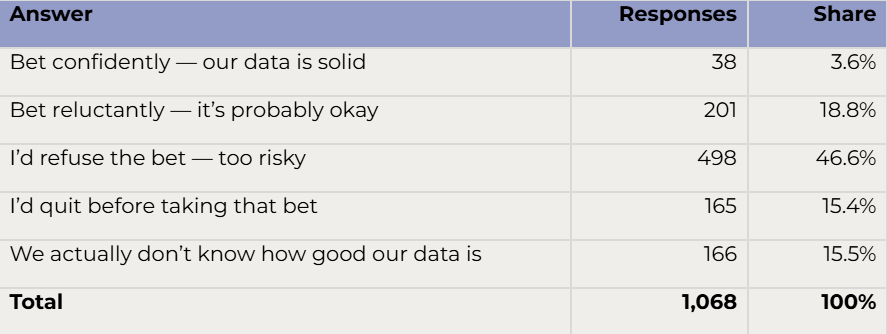

*Data Quality Under the Lens is a new Real World Data Science column. Each edition explores real-world moments where data quality shaped outcomes, sometimes driving failure, sometimes preventing it. From near misses to hard lessons learned, we look at what happens when data is up to the task... or falls short.* 

*If you spot a real world problem and think data quality could lie at the heart of the story, [send it in to the RWDS mailbox]((mailto:rwds@rss.org.uk)) and our Data Quality Detectives will analyse whether the Silent Drift, Proxy Trap, Spreadsheet Cascade, Governance Vacuum or Metric Mirage is responsible.*

## The Case of the Month 

If you ask a roomful of executives whether they would bet their entire annual bonus on the accuracy and completeness of the data feeding their organisation’s most important decisions, the initial reaction is usually laughter. It is the sort of laughter you might hear if you asked someone to renovate an entire house while continuing to live in it. My interpretation of that reaction is that they recognise why the work matters, but they also recognise the disruption, expense, and effort involved.

I know because across 24 cohorts in 2026, I collected 1,068 anonymous responses to this question. Only 38, or 3.6%, said they would bet confidently. Almost two-thirds selected refusal or said they would quit before taking the bet. Another 15.5% did not know how good their data were. (These answers describe confidence; they do not establish the actual quality of any organisation’s data.)

*Table 1: responses to the question: “If you had to bet your entire bonus on the accuracy and completeness of the data feeding your organisation’s most important decision… what would you do?”. See appendix 1 for survey summary.*

My interpretation of the reaction is that leaders can appreciate the importance of trustworthy data while feeling overwhelmed by the work needed to secure it. While my survey does not measure their motives, it provides a starting point for a dilemma I encounter both in teaching and in my conversations with data quality practitioner - and author of [an earlier DQUL column](https://realworlddatascience.net/the-pulse/posts/2026/07/31/DQUL_July.html) - Tom Redman: leaders want better decisions and returns from AI, yet they hesitate to sponsor the changes on which those ambitions depend.

If the task looks like a mountain, how can we help them take the first step?

## What Actually Happened? 

**The Data**
The data I was asking them about feed consequential business decisions. Their required accuracy and completeness depend on the particular use. An organisation therefore needs to identify which data matter for a decision and establish what level of data quality that decision requires.

**The Fault Line**
Improvement can require changes across technology, business processes, responsibilities, and culture. One pension company I recently spoke with began a data quality overhaul after customers spotted discrepancies in their pension data. Five years into the effort, the company expects it to take a further two years for completion.

The immediate task of the pension company was to correct existing data; AI creates another reason to improve how data are produced: reliable, up-to-date inputs support better outputs and, when used for training or updating models, further learning. To a leader expecting to leave in two or three years, either effort can look daunting.

**The Blind Spot**
In discussing our work, Redman and I have defined a few recurring obstacles: the problem is often assigned to IT and is thus siloed, failing to produce organisational level improvements; there is a reluctance to acknowledge poor quality data; and there’s limited enthusiasm for work like this, competing as it does with more visible priorities. Leaders may hesitate to use political capital to change how several functions operate. Treating data as an IT responsibility can leave the business choices unresolved. Technology teams alone cannot define every user’s needs or change the behaviour of those producing the data.

**The Amplifier**
Data move across functions and into reports, models, and automated processes. An error or missing field can affect several downstream uses. As AI consumes those data at greater scale, an unresolved problem can acquire wider consequences. Hesitation among leadership allows the underlying process to continue producing the same problems.

## Disaster or Near-Miss? 
Leaders who depend on data but have little confidence in them face a serious management failure, as they are unable to stand behind the foundation of their most important decisions. That is alarming even when no particular loss has been documented. Our survey reveals expressed doubt or uncertainty; it cannot establish the quality of the data themselves. The pension-company example shows how a concrete problem can force action: customers identified discrepancies, and the organisation began a lengthy effort to address them.

AI creates an opportunity to act before a problem is exposed. The useful safeguard is to choose an important process, establish the necessary quality, and correct the causes of errors. Repairing existing records helps with today’s problem, while improving how new records are created prevents the target from moving as fresh errors arrive.
A single success story, however, may remain isolated. In our discussions, Tom Redman describes how local improvements can fail to become an organisation-wide practice. His lesson is that success does not automatically secure support for the next project. Leaders need to make that next commitment explicitly.

Visible sponsorship matters because the next improvement may require cooperation from another function, changes to established routines, or resources that a local team cannot secure. A senior sponsor can resolve competing priorities and protect the work. The first benefit gives that sponsor evidence to justify continuing.

## Why This Matters Now 
AI gives leaders a reason to act. Many organisations want to redesign processes around AI and demonstrate a financial return, so where those applications depend on operational data, the reliability of their inputs becomes part of the business case. A data platform such as Databricks can be part of the technical infrastructure, but investment in a platform does not itself make a missing record appear or settle conflicting business definitions. The organisation must also improve the process that creates and maintains those data.

The INSEAD webinar summarised in [“Your AI Is Only as Good as Your Data”](https://knowledge.insead.edu/operations/your-ai-only-good-your-data) makes this practical. Kinda El Maarry described an improvement at HelloFresh when the people producing data understood the consequences for those using it. Redman’s advice was to find a problem and a person willing to solve it. Those are starting points that a leader can recognise and support.

An AI initiative can provide that starting point. Select a valuable process, identify the data it needs, and improve their fitness for that use. This connects data quality to an outcome the organisation already wants, while making the first commitment manageable.

## The Practitioner Takeaway: stop staring at the whole mountain! 
Choose one important problem and someone willing to solve it.

1. Choose a process or decision where poor data already create costly work or obstruct a valuable AI application. Give a business owner responsibility for the outcome.
2. Map the critical data and connect the people creating them with those using them. Agree what ‘accurate and complete’ mean for this use and measure the current gaps.
3. Fix how the data are produced, as well as correcting existing records. Otherwise, new errors will keep coming.
4. Measure the business benefit, such as less reconciliation, faster processing, or a more reliable decision. Recognise the people who delivered it.
5. Use the evidence to justify and, where possible, fund the next project. Have an executive explicitly sponsor the next step, resolve obstacles across functions, and review progress.

The programme may take years. Its benefits should begin along the way, with each improvement creating a stronger reason to continue.

## The Data Quality Pattern
The underlying pattern here is what we, at Data Quality Under the Lens, call a **Governance Vacuum**, that is, a gap in ownership and authority. Responsibility for data-dependent decisions may be clear, while responsibility for making the underlying data fit for those decisions remains diffuse. Leaders may delegate the task without giving anyone the authority to change processes across functions. A single success story can then stall at the next organisational boundary. Closing this gap requires a business owner, cooperation between data producers and users, and a sponsor who protects the effort. Small projects make the work approachable; visible leadership commitment helps turn a sequence of projects into lasting organisational practice.

## A leader leaving in three years need not wait seven years to show progress
One important process can become more reliable during that tenure, with a measurable benefit and people capable of repeating the work elsewhere. That creates an opportunity to leave both an early result and the foundations for continued improvement.
My survey question should therefore lead to a second question: what could you change first to make my bet less frightening? The first step does not require a promise to fix everything. It requires a specific problem, an owner willing to act, and leadership prepared to help them succeed.

## Sources for the Column

Survey: 1,068 anonymous submissions across 24 cohorts, 20 January–8 October 2026. Cohort-size quartiles use linear interpolation, which explains the fractional values.

Published account: INSEAD Knowledge, [“Your AI Is Only as Good as Your Data”](https://knowledge.insead.edu/operations/your-ai-only-good-your-data), 8 September 2026.

Tom Redman: personal interviews on leadership, political capital, IT responsibility, and the limits of local success. His observations are paraphrased without identifying organisations.

The pension-company example comes from my recent conversation. The leadership explanation is my interpretation informed by teaching and practitioner discussions.

## Appendix 1: Survey summary
Between 20 January and 8 October 2026, I collected 1,068 anonymous responses across 24 cohorts. These included company-specific executive sessions, open-enrolment programmes, and an alumni event with participants from many organisations. The number of distinct companies represented was not recorded. The number of responses per cohort ranged from 11 to 186, with a median of 32.5 and a mean of 44.5. The lower and upper quartiles were 18.75 and 41.25 responses, respectively.

Only 38 respondents (3.6%) would bet confidently. Refusal or quitting accounted for 62.1%; another 166 respondents (15.5%) did not even know how good their data were. Together, refusal, quitting, and uncertainty accounted for 77.6% of responses and formed a majority in 20 of the 24 cohorts. Percentages are pooled across responses and may not sum to 100% because of rounding.

These classroom polls measure expressed confidence, rather than independently verified data quality. They are a convenience sample, with no claim to represent all executives.

::: {.further-info}
::: grid

::: {.g-col-12 .g-col-md-12}
About the author:
: **Ville Satopaa** is is an Associate Professor of Technology and Operations Management at [INSEAD](https://www.insead.edu/). Before joining INSEAD, Ville received his MA and Ph.D. degrees in Statistics from the Wharton School of the University of Pennsylvania. He also holds a BA in Mathematics and Computer Sciences from Williams College. His current research studies collective intelligence of humans and/or AI in forecasting and decision-making and his work has been published in [Journal of the American Statistical Association](https://www.tandfonline.com/journals/uasa20), [Annals of Applied Statistics](https://projecteuclid.org/journals/annals-of-applied-statistics) and more. 

::: {.g-col-12 .g-col-md-6}
**Copyright and licence** : © 2026 Ville Satopaa  

This article is licensed under a Creative Commons Attribution 4.0 (CC BY 4.0)
<a href="http://creativecommons.org/licenses/by/4.0/?ref=chooser-v1" target="_blank" rel="license noopener noreferrer" style="display:inline-block;">International licence</a>.
:::

::: {.g-col-12 .g-col-md-6}
**How to cite** :  
Satopaa, Ville 2026. “**Data Quality Under the Lens: Can Executives Take the Bonus Bet**” *Real World Data Science*, 2026. [URL](https://realworlddatascience.net/the-pulse/posts/2026/10/DQ_Bonus_Bet.qmd)
:::

:::
:::

